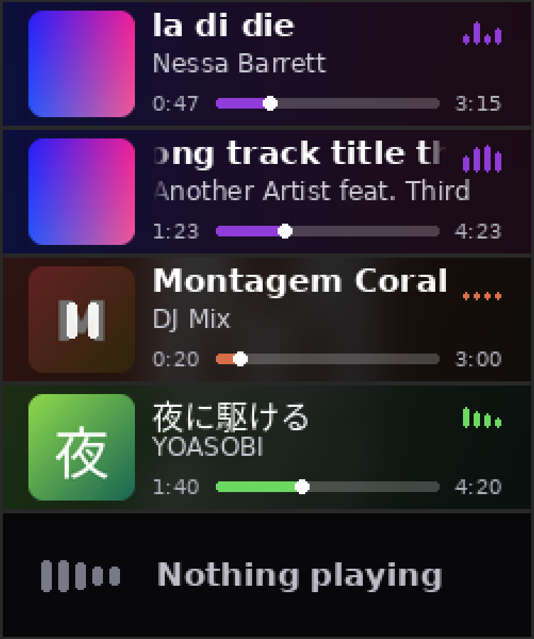

# Neo Now Playing — a StreamController plugin for the Stream Deck Neo infobar

Shows what is playing on the **infobar of the Elgato Stream Deck Neo** (248 × 58 px), drawn to fit that
display exactly: cover art, title and artist (scrolling when too long), progress bar with elapsed/total time,
an animated equalizer and an accent colour taken from the cover.



*(Frames rendered offline with `tests/render_demo.py`, magnified 3×. Replace with a photo of your device if you like.)*

It is a standalone plugin with its own ID (`com_user_NeoNowPlaying`), so updates of the stock MediaPlugin
never overwrite it. It reads MPRIS directly, so it works with any MPRIS player (Spotify, browsers, VLC, …).

## Status

Written and tested by one person on **Arch Linux, KDE Plasma 6 (Wayland), Flatpak StreamController 1.5.0-beta,
Stream Deck Neo**, mainly with YouTube Music in Chrome. It has not been tested on other setups — bug reports
and pull requests are welcome. Linux only (MPRIS / D-Bus).

## Install

Requirements: StreamController (tested: Flatpak `com.core447.StreamController`), Python Pillow (bundled with
StreamController), a Stream Deck Neo.

```sh
flatpak kill com.core447.StreamController
git clone https://github.com/theclubmrzer/NeoNowPlaying \
  ~/.var/app/com.core447.StreamController/data/plugins/com_user_NeoNowPlaying
flatpak run com.core447.StreamController      # run from a terminal to see the logs
```

(Or download the ZIP and unpack it so that `manifest.json` ends up in
`…/data/plugins/com_user_NeoNowPlaying/manifest.json`. The folder name must match the plugin ID.)

Then, on the **Infobar** key of your Neo, add the action **Neo Now Playing (infobar)** (remove any old
"Info (Media)" action from it first).

## Settings (action configuration)

Player (automatic or a specific one) · accent colour (from cover / fixed hex) · animated equalizer ·
times next to the progress bar · animation FPS · **left/right margin** (the Neo bezel clips the edges of the
infobar; defaults are 12 / 14 px) · debug files.

Pressing the key the action sits on toggles play/pause (the infobar itself has no touch input).

## Cover art

The plugin gets the cover URL from MPRIS (`mpris:artUrl`) and tries, in this order:

1. An `https://`, `http://` or `data:` URL — downloaded directly (Spotify, many players).
2. A `file://` path — read directly if the sandbox can see it.
3. A copy of that file made by the optional host helper (below).
4. A URL sent by the optional browser userscript (below).
5. Otherwise a generated placeholder (gradient + first letter of the title).

**Why the helpers exist:** browsers and `plasma-browser-integration` write the cover to a file in the host
`/tmp`, and the Flatpak StreamController has its own private `/tmp`, so it cannot open it. Pick one:

### Option A — host helper service (recommended for Plasma Integration / Chromium-based browsers)

Requires `playerctl`. It copies cover files from the host `/tmp` into a folder the Flatpak can read
(`~/.var/app/com.core447.StreamController/data/neonp-art`) and deletes copies older than 4 hours.

```sh
mkdir -p ~/.local/bin ~/.config/systemd/user
cp extras/neonp-art-sync.sh ~/.local/bin/ && chmod +x ~/.local/bin/neonp-art-sync.sh
cp extras/neonp-art-sync.service ~/.config/systemd/user/
systemctl --user daemon-reload
systemctl --user enable --now neonp-art-sync.service
```

### Option B — browser userscript (YouTube Music, YouTube, Spotify Web)

Install `extras/neonp-bridge.user.js` in Violentmonkey/Tampermonkey. It posts the cover URL from
`navigator.mediaSession` to a tiny HTTP server the plugin runs on `127.0.0.1:47821`. The server accepts only
`https` URLs from a short list of image CDNs (see `ALLOWED_SUFFIXES` in `neonp_art.py`) and requires a custom
header, so ordinary web pages cannot use it. This assumes the Flatpak shares the host network.

## Troubleshooting

* `…/com_user_NeoNowPlaying/debug/status.txt` shows which player was chosen, its `artUrl` and why loading
  succeeded or failed. `debug/last_frame.png` is the last frame sent to the device.
* Logs: `flatpak run com.core447.StreamController 2>&1 | grep NeoNowPlaying` (also prints the deck's image
  geometry on start).
* Image squashed or mis-sized? Open an issue and paste the geometry log line.
* Text cut off at the edges? Increase the margins in the action settings.
* Nothing shown at all? Check `playerctl -l` lists your player and that the Flatpak may talk to
  `org.mpris.MediaPlayer2.*` (the plugin requests this permission on first start).

## How it works

* `neonp_mpris.py` — polls MPRIS over D-Bus (Gio) once per second and extrapolates the position between polls.
* `neonp_art.py` — cover loading, the optional localhost bridge.
* `neonp_render.py` — Pillow renderer; no StreamController dependency (`python3 tests/render_demo.py`).
* `main.py` — StreamController plugin/action glue and settings UI. A render thread draws at the configured FPS
  while playing and goes quiet (no USB writes) when nothing changes.

## License

MIT (see `LICENSE`). Bundled DejaVu fonts keep their own license (`assets/fonts/DEJAVU-LICENSE.txt`).
Not affiliated with Elgato or the StreamController project.

Written with the help of Claude (Anthropic), then tested and maintained by theclubmrzer.
